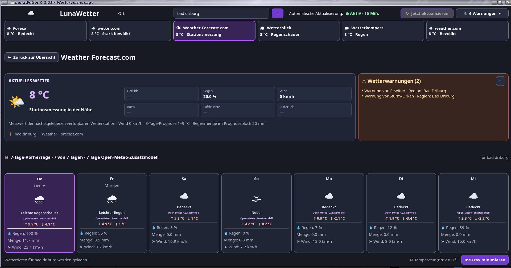

# LunaWetter 0.1.24

Wettervergleich mit sechs öffentlichen Wetterquellen für Debian 13 (Trixie) und Raspberry Pi (arm64).



[Github Seite](https://github.com/Angonikro/LunaWetter/)

## Funktionen

- Graphit-Oberfläche mit violetten Akzenten
- Vergleich von sechs öffentlichen Wetterquellen: Foreca, MET Norway, DWD ICON, Wetterblick, Wetterkompass und weather.com
- Ortssuche und parallele Hintergrundabfrage
- GTK-3-System-Tray mit Temperaturdurchschnitt und Warnhinweisen
- Automatische Aktualisierung alle 15 Minuten
- Wetterwarnungen in einem einklappbaren Bereich
- Anbieter-Detailansicht mit bis zu sieben Vorhersagetagen
- Fehlende Vorhersagetage können mit dem Open-Meteo-Zusatzmodell ergänzt werden. Ergänzte Werte werden in der Oberfläche ausdrücklich als **„Open-Meteo · Zusatzmodell“** gekennzeichnet.

## Hinweise zu den Wetterdaten

LunaWetter liest öffentliche Wetterseiten und verwendet für die Ergänzung fehlender Vorhersagetage die dokumentierten öffentlichen Open-Meteo-Endpunkte. Es wird kein API-Schlüssel benötigt.

Die Datenverfügbarkeit und die angebotenen Vorhersagezeiträume können je nach Anbieter und Ort variieren. Nicht gelieferte Werte werden nicht als Messwerte ausgegeben. Ergänzte Modellwerte sind in der Anwendung gekennzeichnet und nicht mit Originaldaten des ausgewählten Anbieters gleichzusetzen.

Ein fehlender Warnhinweis in LunaWetter bedeutet nicht automatisch, dass amtlich keine Wettergefahr besteht.

## Installation als Debian-Paket (DEB)

Die DEB-Installation ist der einfachste Weg. APT installiert dabei auch die in den Paketabhängigkeiten angegebenen benötigten Systempakete.

1. Terminal im Download-Ordner öffnen.
2. Paket installieren:

```bash
sudo apt install ./lunawetter_0.1.24_all.deb
```

Falls APT nachfragt, die Installation mit `J` bestätigen.

### LunaWetter starten

Nach der Installation gibt es zwei Möglichkeiten:

- Im Anwendungsmenü **LunaWetter** auswählen.
- Im Terminal starten:

```bash
lunawetter
```

### Deinstallieren

```bash
sudo apt remove lunawetter
```

Dabei bleiben persönliche Einstellungen im Benutzerprofil normalerweise erhalten. Zum Entfernen der Paket-Konfigurationsdateien kann stattdessen `sudo apt purge lunawetter` verwendet werden.

## Start aus dem ZIP-Archiv

Die ZIP-Version wird nicht systemweit installiert. Sie kann direkt aus dem entpackten Projektordner gestartet werden.

### Benötigte Pakete installieren

Auf Debian 13 / Raspberry Pi OS auf Debian-Basis zuerst die Laufzeitabhängigkeiten installieren:

```bash
sudo apt update
sudo apt install python3 python3-pyside6.qtwidgets python3-gi gir1.2-gtk-3.0
```

### ZIP entpacken

Wechsle im Terminal in den Ordner, in dem die ZIP-Datei liegt, und entpacke sie:

```bash
unzip LunaWetter_0.1.24_GITHUB.zip
```

Falls `unzip` noch nicht installiert ist:

```bash
sudo apt install unzip
```

### Anwendung starten

In den entpackten Projektordner wechseln und LunaWetter starten:

```bash
cd lunawetter
python3 -m lunawetter
```

Wichtig: Der Startbefehl muss im Ordner `lunawetter` ausgeführt werden, in dem sich auch der Projekt-Unterordner `lunawetter/` befindet.

## Welche Variante soll ich verwenden?

- **DEB:** Empfohlen für den normalen Gebrauch. LunaWetter wird systemweit installiert, ein Menüeintrag wird angelegt und der Befehl `lunawetter` steht im Terminal zur Verfügung.
- **ZIP:** Geeignet zum Ausprobieren oder wenn LunaWetter ohne systemweite Installation aus dem entpackten Ordner gestartet werden soll. Die benötigten Debian-Pakete müssen vorher installiert sein.

## Einstellungen

Der gespeicherte Ort und die Fenstergeometrie werden benutzerspezifisch hier abgelegt:

```text
~/.config/Goldisoft/LunaWetter.conf
```

## Fehlerdiagnose

Wenn sich die Anwendung nicht starten lässt, kann sie aus dem Terminal gestartet werden, damit Fehlermeldungen sichtbar bleiben:

```bash
lunawetter
```

Bei der ZIP-Version:

```bash
cd lunawetter
python3 -m lunawetter
```

Fehlende Python-/Qt-/GTK-Module unter Debian können mit folgendem Befehl nachinstalliert werden:

```bash
sudo apt install python3-pyside6.qtwidgets python3-gi gir1.2-gtk-3.0
```

73 de DO2QG Andreas
